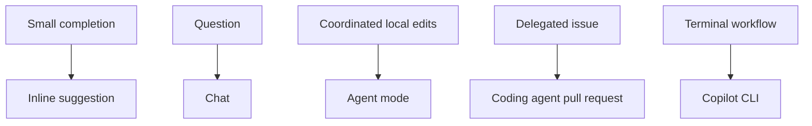

# Use GitHub Copilot features

This is the largest GH-300 domain. Know where each feature runs, how it receives context, its autonomy, and which plan or policy governs access.

<figure class="product-visual">
    
    <figcaption>Official GitHub Docs product visual: the interactive <a href="https://docs.github.com/en/copilot/concepts/agents/about-copilot-cli">GitHub Copilot CLI</a> interface.</figcaption>
</figure>

| Surface | Best fit | Key distinction |
| --- | --- | --- |
| Inline suggestions | Completing code while typing | Accept, partially accept, cycle, or dismiss suggestions |
| Copilot Chat | Questions, explanations, and scoped changes | Uses conversation and selected workspace context |
| Agent mode | Multi-step implementation in an IDE | Selects files, proposes edits, and runs approved tools |
| Copilot coding agent | Delegated GitHub task | Works independently and opens a pull request |
| Copilot code review | Review feedback | Suggests improvements; humans retain approval |
| Copilot CLI | Terminal-native assistance | Supports commands, scripts, files, and interactive sessions |
| Copilot on GitHub | Pull requests, summaries, Spaces, and repository tasks | Uses GitHub-hosted context |

## IDE context and customization

Context can include the active file, selection, open files, chat history, repository instructions, attached references, and tool results. Give only relevant context and state the goal, constraints, and acceptance criteria.

- Repository and path-specific instructions provide persistent conventions.
- Prompt files package repeatable task instructions.
- Custom agents define specialized roles, tools, and workflows.
- Model Context Protocol (MCP) servers expose approved external tools and data.
- Subagents isolate specialized work and conserve parent-agent context.

Instructions guide model behavior; permissions, policies, branch rules, and review processes enforce controls.

### Ask, Plan, and Agent modes

Microsoft Learn distinguishes three built-in local roles. Choose by the result you need and the amount of change Copilot should be allowed to make.

| Mode | What it does | Use it when |
| --- | --- | --- |
| Ask | Explains and analyzes without changing files or invoking tools | Comparing approaches, finding edge cases, or understanding code |
| Plan | Researches with read-only tools and creates an implementation plan | Requirements or sequencing need review before edits begin |
| Agent | Edits files, invokes tools, runs commands, and iterates on failures | The goal is defined and implementation should proceed |

Plan mode does not make code changes. After reviewing its questions and proposed steps, you can start implementation in Agent mode or open the plan as Markdown. Agent mode maintains a working set, streams edits, and can self-correct from compiler or test output, but its work still requires review.

### Context controls in chat

- Use **Add Context**, drag and drop, or `#` mentions to attach files, folders, symbols, and selections.
- Use `#selection` for a precise selected block and `#codebase` when repository search is necessary.
- Use slash commands for repeatable operations; available commands depend on the client and current product version.
- Inspect the response's references to understand which files and instructions informed it.
- Start a new thread when prior conversation no longer supports the task.

## CLI and administration

Follow the current [Copilot CLI documentation](https://docs.github.com/en/copilot/concepts/agents/about-copilot-cli) for installation and authentication. In a session, inspect requested permissions, approve only necessary tool use, and validate changed files and generated scripts.

Copilot CLI supports two interfaces:

| Interface | Invocation | Behavior |
| --- | --- | --- |
| Interactive | Run `copilot` | Holds a steerable conversation with ask/execute and plan modes |
| Programmatic | Run `copilot -p "PROMPT"` | Performs one task and exits; useful in constrained automation |

In interactive mode, use `Shift`+`Tab` to cycle modes. Local sandboxing can restrict filesystem, network, and system access; cloud sandboxing provides an isolated hosted session. Preview status and availability can change, so verify the current documentation.

Permission flags deserve special attention. `--allow-tool` grants a named tool without repeated approval, `--deny-tool` takes precedence and blocks a tool, and `--allow-all-tools` removes individual approval prompts. Broad automatic approval gives the agent the same effective command and file access as the user, so prefer narrow permissions and a sandbox for unattended work. Launch the CLI only inside a trusted, appropriately scoped directory.

Customization can include repository instructions, MCP servers, custom agents, hooks, skills, and Copilot Memory. Hooks can add deterministic validation or logging around agent actions; MCP extends available data and tools; memory can retain repository conventions. Each changes context or capability, not the developer's obligation to validate results.

| Administrative need | Relevant control |
| --- | --- |
| Assign access | Subscription and seat management |
| Permit capabilities | Organization or enterprise Copilot policies |
| Investigate changes | Audit log events |
| Automate seat management | GitHub REST API for Copilot |
| Standardize reviews | Code review policy and custom instructions |

Plans change frequently. Compare current [GitHub Copilot plans](https://docs.github.com/en/copilot/about-github-copilot/plans-for-github-copilot) rather than memorizing a stale feature matrix.

## Readiness check

- When is agent mode a better fit than an inline suggestion?
- How does a coding agent normally return work to a team?
- Where can an administrator investigate policy activity?

<b>Suggested answers</b>

1. For multi-step work requiring coordinated edits, tools, and validation.
2. Through a pull request from its isolated environment.
3. In the audit log and relevant organization or enterprise settings.

