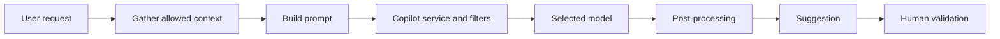

# Understand GitHub Copilot data and architecture

Copilot assembles allowed context into a prompt, sends it through GitHub's service, receives model output, applies processing, and presents a suggestion. Retention and model behavior depend on the plan, feature, settings, and current product terms.

*Conceptual study flow. Use the [GitHub Copilot Trust Center](https://copilot.github.trust.page/) for current data-handling details.*

## Prompt inputs

| Potential input | Purpose |
| --- | --- |
| User prompt and nearby code | Express the immediate task and intent |
| Active selection and file | Supply implementation and language context |
| Open files or workspace index | Add related project context when supported |
| Chat history | Carry earlier constraints forward |
| Instructions and references | Add conventions or explicit sources |
| Tool results | Ground an agent in tests, searches, or external systems |

Content exclusions can stop configured paths from informing supported features, but support varies. Exclusion is not a substitute for repository access control or secret management.

## Suggestion lifecycle

1. The client identifies context for the interaction.
2. It constructs a prompt within product and model limits.
3. The service applies policy and safety processing.
4. The selected model generates candidate output.
5. Post-processing filters or ranks the result.
6. The client presents output for acceptance, rejection, or revision.
7. The developer validates the final change.

Large language models predict likely output; they do not guarantee truth or automatically know private facts that were not supplied. Output can vary with wording, context order, model, and product updates. Long chats can dilute context, so restate critical constraints or start a focused session.

Review the [GitHub Copilot Trust Center](https://copilot.github.trust.page/) and [Copilot documentation](https://docs.github.com/en/copilot) for current behavior.

## Readiness check

- Why can the same prompt produce different output?
- Why is content exclusion not an access-control system?
- Why is this flow not a promise about retention?

<b>Suggested answers</b>

1. Generation is probabilistic and varies with model, context, settings, and updates.
2. It controls supported Copilot context, not who can read the repository or file.
3. Retention depends on current terms, plan, feature, and settings.

