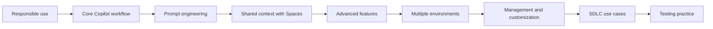
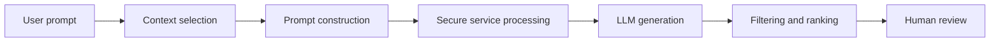

# GitHub Copilot Fundamentals Part 1

This page condenses the nine modules in the official [GitHub Copilot Fundamentals Part 1](https://learn.microsoft.com/en-us/training/paths/copilot/) learning path. It is an original review aid, not a replacement for the Microsoft Learn explanations, exercises, knowledge checks, or current product documentation.

| Module | Time | Main outcome |
| --- | ---: | --- |
| Responsible AI with GitHub Copilot | 15 min | Recognize AI risks and apply six responsible AI principles |
| Introduction to GitHub Copilot | 19 min | Configure Copilot and use code suggestions effectively |
| Introduction to prompt engineering | 30 min | Build precise prompts and understand prompt processing |
| Introduction to Copilot Spaces | 31 min | Ground collaboration in curated shared context |
| Using advanced GitHub Copilot features | 22 min | Apply advanced IDE techniques to an existing application |
| Copilot across environments | 53 min | Choose among IDE, Chat, GitHub.com, CLI, and the Copilot app |
| Management and customization | 30 min | Select plans, configure policy, exclusions, and troubleshooting |
| Developer use cases for AI | 49 min | Apply Copilot across the SDLC and measure impact |
| Develop unit tests with Copilot tools | 68 min | Plan, generate, run, repair, and review tests |

**Approximate path time:** 317 minutes. Times come from the Microsoft Learn catalog and can change.

## 1. Responsible AI with GitHub Copilot

The module begins with the risks of generative AI, then applies Microsoft and GitHub's six responsible AI principles: fairness, reliability and safety, privacy and security, inclusiveness, transparency, and accountability.

### Core ideas

- Copilot output can be plausible but inaccurate, insecure, biased, outdated, or overly similar to public code.
- Human developers remain accountable for understanding, testing, approving, and operating generated changes.
- Risk mitigation starts before prompting: classify the task, minimize sensitive context, and decide whether AI is appropriate.
- Validation should combine domain review, automated tests, security tools, and normal change controls.
- Transparency includes making AI involvement and limitations understandable to affected users and reviewers.

### Study checkpoint

Given a generated authentication handler, identify at least one concern under each of reliability, privacy, security, and accountability. Explain which checks would provide evidence rather than reassurance.

Complete the [Responsible AI with GitHub Copilot module](https://learn.microsoft.com/en-us/training/modules/responsible-ai-with-github-copilot/).

## 2. Introduction to GitHub Copilot

This module establishes Copilot as an AI pair programmer, covers ways to trigger suggestions, and walks through setup, configuration, troubleshooting, and an exercise in Visual Studio Code.

<figure class="product-visual">
    
    <figcaption>Official GitHub Docs product visual: open <a href="https://docs.github.com/en/copilot/how-tos/chat-with-copilot/chat-in-ide">Copilot Chat in Visual Studio Code</a>.</figcaption>
</figure>

### Core ideas

- Inline suggestions complete code at the cursor; Chat supports questions, explanations, and larger iterative tasks.
- Suggestions can be triggered by existing code, comments, function names, and natural-language requests.
- Entitlement, client support, extension state, authentication, network access, and organization policy all affect availability.
- Plans differ in included features, administration, policy, and usage. Verify the current plan matrix rather than memorizing a static list.
- Troubleshooting should isolate account, seat, policy, client, extension, connectivity, and repository-specific causes.

### Hands-on checkpoint

Install or enable Copilot, generate a small function from a descriptive name and comment, cycle through alternatives, accept only part of a suggestion, then ask Chat to explain and test the result.

Complete [Introduction to GitHub Copilot](https://learn.microsoft.com/en-us/training/modules/introduction-to-github-copilot/).

## 3. Introduction to prompt engineering

The prompt-engineering module connects prompt structure to the internal request flow, data handling, and the probabilistic behavior of large language models.

### Core ideas

1. State the broad goal, then list specific requirements and constraints.
2. Add relevant code, examples, expected output, and acceptance criteria.
3. Break a complex task into smaller independently verifiable steps.
4. Name the exact file, symbol, library, or prior response to remove ambiguity.
5. Keep chat history relevant; start a new thread when context becomes stale.
6. Treat role prompting as guidance for focus and style, not as an authority or security boundary.

### Prompt process to remember

Model output varies because generation is probabilistic and because context, model selection, product settings, and service behavior can differ. More context is not always better; relevance matters more than volume.

Complete [Introduction to prompt engineering with GitHub Copilot](https://learn.microsoft.com/en-us/training/modules/introduction-prompt-engineering-with-github-copilot/).

## 4. Introduction to Copilot Spaces

Copilot Spaces organize repositories, issues, pull requests, files, free-text notes, and instructions into a shared context for focused conversations. The goal is to make team knowledge discoverable and produce responses grounded in approved sources.

### Create and govern a useful Space

| Step | Decision |
| --- | --- |
| Define purpose | Name the audience, recurring questions, and desired outcome |
| Add sources | Include authoritative, current, minimum-necessary context |
| Add instructions | Explain terminology, response style, priorities, and boundaries |
| Test questions | Verify answers cite the expected source and expose gaps |
| Share access | Match visibility to the sensitivity of included sources |
| Maintain | Remove stale sources and update instructions as work changes |

### Do and do not

- Do create a focused Space for a product, incident process, onboarding flow, or architectural area.
- Do include source material that answers the questions users are expected to ask.
- Do verify access and governance before sharing.
- Do not treat a Space as an uncurated dump of every available document.
- Do not assume instructions override repository permissions or organizational policy.
- Do not trust an answer whose source is stale, missing, or outside the Space's intended scope.

Complete [Introduction to Copilot Spaces](https://learn.microsoft.com/en-us/training/modules/introduction-copilot-spaces/), including the tribal-knowledge exercise.

## 5. Using advanced GitHub Copilot features

This applied module uses an existing Python web API to practice advanced capabilities rather than isolated completions.

### Applied workflow

1. Inspect the repository, dependencies, tests, and existing conventions.
2. Use Chat to explain unfamiliar code and identify the smallest change surface.
3. Provide references and constraints before requesting an implementation.
4. Generate or update code in reviewable increments.
5. Ask for tests that cover normal, boundary, and failure behavior.
6. Run the application and test suite, then use actual failures to guide refinement.
7. Review the final diff for unrelated changes, security, readability, and compatibility.

The module's key lesson is not a particular language feature. It is the loop between context, generated changes, executable validation, and human review.

Complete [Using advanced GitHub Copilot features](https://learn.microsoft.com/en-us/training/modules/advanced-github-copilot/).

## 6. GitHub Copilot across environments

Copilot follows development work across several surfaces. Choose based on task location, context, and desired autonomy.

<figure class="product-visual">
    
    <figcaption>Official GitHub Docs product visual: an interactive <a href="https://docs.github.com/en/copilot/concepts/agents/about-copilot-cli">Copilot CLI</a> session.</figcaption>
</figure>

| Environment | Strong use case | Context or control to inspect |
| --- | --- | --- |
| IDE completion | Code at the cursor and repetitive patterns | Active file, neighboring code, accepted suggestion |
| IDE Chat | Explanation, planning, edits, and local tools | References, mode, model, permissions |
| GitHub.com | Repositories, issues, pull requests, and shared collaboration | Repository scope and organization policy |
| Copilot CLI | Terminal tasks, Git operations, scripts, and GitHub interaction | Trusted directory and tool approvals |
| Copilot app | Agent-centered workflows across projects | Session context, tools, and handoff |

Complete [GitHub Copilot across environments](https://learn.microsoft.com/en-us/training/modules/github-copilot-across-environments/).

## 7. Management and customization

This module connects plan selection with governance, contractual protections, public-code controls, content exclusions, customization, and troubleshooting.

<figure class="product-visual">
    
    <figcaption>Official GitHub Docs product visual: audit details for a <code>copilot.content_exclusion_changed</code> event.</figcaption>
</figure>

### Governance layers

| Layer | Examples |
| --- | --- |
| Subscription | Plan, seats, included features, usage and billing |
| Enterprise or organization | Feature policies, model access, public-code matching, MCP availability |
| Repository | Instructions, content exclusions, agent environment, MCP tools |
| Client | Extension, editor settings, model, mode, local permissions |
| Workflow | Review requirements, tests, scanning, branch rules, deployment approvals |

For a failed feature, identify the user and account, assigned seat, plan, policy scope, supported client, extension version, authentication state, and repository context before reinstalling tools. For exclusions, also verify pattern syntax, feature support, propagation, and audit history.

Complete [Management and customization considerations with GitHub Copilot](https://learn.microsoft.com/en-us/training/modules/github-copilot-management-and-customizations/).

## 8. Developer use cases across the SDLC

This module moves from individual coding assistance to lifecycle outcomes: productivity, developer preference, planning, implementation, quality, deployment, maintenance, limitations, and measurement.

| SDLC phase | Copilot contribution | Evidence to require |
| --- | --- | --- |
| Requirements | Prototype structures and translate stories | Stakeholder-confirmed acceptance criteria |
| Design | Compare patterns and draft interfaces | Recorded tradeoffs and architecture review |
| Development | Generate boilerplate, refactor, explain, translate | Build, tests, code review |
| Testing | Propose cases, data, assertions, and automation | Meaningful failures and coverage review |
| Deployment | Draft configuration, scripts, and documentation | Environment validation and approval |
| Maintenance | Explain legacy code and suggest targeted fixes | Reproduction and regression tests |

Measure complete outcomes such as lead time, review time, rework, escaped defects, test quality, and developer satisfaction. Generated lines or accepted suggestions alone do not prove productivity.

Complete [Developer use cases for AI with GitHub Copilot](https://learn.microsoft.com/en-us/training/modules/developer-use-cases-for-ai-with-github-copilot/).

## 9. Develop unit tests using Copilot tools

The final Part 1 module is the longest and most hands-on. It covers VS Code test support, Chat-based generation, Plan and Agent modes, inline ghost text, failing-test repair, and a complete C# exercise.

### End-to-end test workflow

1. Confirm the test framework, project references, discovery, and baseline suite.
2. Use Ask mode to enumerate behavior, boundaries, invalid inputs, and dependencies.
3. Use Plan mode when test architecture or project setup spans multiple steps.
4. Use Agent mode with default approvals to create tests, invoke tools, and run them.
5. Use `/setupTests` when a framework is absent and `/tests` for active code or a selection.
6. Review every assertion, mock, fixture, name, and changed file.
7. Prove a test is meaningful by observing it fail for the defect it claims to detect.
8. Keep shared test conventions in path-specific instruction files.

Generated tests can mirror an implementation bug, overfit to current internals, omit boundaries, misuse mocks, or pass without reaching the intended path. Human review remains mandatory.

Complete [Develop unit tests using GitHub Copilot tools](https://learn.microsoft.com/en-us/training/modules/develop-unit-tests-using-github-copilot-tools/).

## Part 1 completion checklist

- [ ] I can explain all six responsible AI principles with a development example.
- [ ] I can distinguish inline suggestions, Chat, and terminal assistance.
- [ ] I can write a prompt with goal, context, constraints, examples, and acceptance criteria.
- [ ] I can design and govern a focused Copilot Space.
- [ ] I can apply the generate-review-test-refine loop to an existing codebase.
- [ ] I can choose the correct Copilot environment for a scenario.
- [ ] I can trace a configuration issue across plan, policy, repository, and client layers.
- [ ] I can identify useful Copilot applications and limitations across the SDLC.
- [ ] I can generate tests while independently verifying their behavior and coverage.