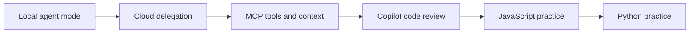
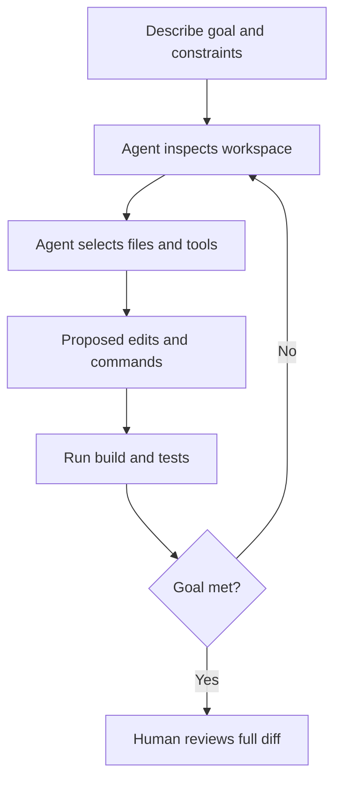

# GitHub Copilot Fundamentals Part 2

This page condenses the six modules in the official [GitHub Copilot Fundamentals Part 2](https://learn.microsoft.com/en-us/training/paths/gh-copilot-2/) learning path. Use it to connect agentic features, external tools, code review, and language-specific practice. Complete the official exercises for hands-on experience.

| Module | Time | Main outcome |
| --- | ---: | --- |
| Build applications with agent mode | 50 min | Let an IDE agent plan, edit, run tools, and iterate locally |
| Accelerate development with Copilot Cloud Agent | 35 min | Delegate GitHub-hosted tasks and review agent pull requests |
| Introduction to MCP Server | 35 min | Connect approved external tools and context to Copilot |
| Level up code reviews and pull requests | 38 min | Request, customize, automate, and measure Copilot reviews |
| Use Copilot with JavaScript | 22 min | Apply suggestions and Chat to a JavaScript portfolio |
| Use Copilot with Python | 22 min | Apply suggestions and Chat to a Python web API |

**Approximate path time:** 202 minutes. Together, Parts 1 and 2 contain about 519 minutes of Microsoft Learn coursework before optional exercises and repetition.



## 1. Build applications with agent mode

Agent mode is the local autonomous implementation surface. Given a goal, it can discover relevant files, create a plan, edit multiple files, invoke tools, run terminal commands, observe failures, and iterate toward completion.

### Agent loop



### Use agent mode well

- Give a concrete outcome, scope, constraints, and executable acceptance criteria.
- Start from a trusted directory and inspect tool or terminal permission requests.
- Attach authoritative files or let the agent search the workspace when discovery is part of the task.
- Keep changes reviewable; split large goals into milestones that can be tested independently.
- Review every changed file, not only the agent's summary.
- Run the final validation yourself when the result affects production behavior.

### Distinguish adjacent modes

| Mode | Changes files? | Runs tools? | Best use |
| --- | --- | --- | --- |
| Ask | No | No | Explanation and exploration |
| Plan | No | Read-only analysis | Requirements, design, and sequencing |
| Agent | Yes | Yes, with configured approvals | Local multi-step implementation |

The module's GitHub Skills exercise is important because agent mode is learned through supervision: observe its plan, approve narrowly, inspect intermediate results, and correct course when assumptions are wrong.

Complete [Building applications with GitHub Copilot agent mode](https://learn.microsoft.com/en-us/training/modules/github-copilot-agent-mode/).

## 2. Accelerate development with Copilot Cloud Agent

Copilot Cloud Agent works asynchronously in a GitHub Actions-powered ephemeral environment. It can research a repository, plan, change one branch, run tests and linters, and create or update a pull request while the developer works elsewhere.

<figure class="product-visual">
    <a href="https://docs.github.com/en/copilot/using-github-copilot/using-copilot-coding-agent-to-work-on-tasks/reviewing-a-pull-request-created-by-copilot"></a>
    <figcaption>Official GitHub Docs product visual: workflows on an agent-created pull request require deliberate <a href="https://docs.github.com/en/copilot/using-github-copilot/using-copilot-coding-agent-to-work-on-tasks/reviewing-a-pull-request-created-by-copilot">review and approval</a> by default.</figcaption>
</figure>

### Local agent mode versus cloud agent

| Dimension | IDE agent mode | Copilot Cloud Agent |
| --- | --- | --- |
| Environment | Developer's local workspace | Ephemeral GitHub Actions environment |
| Interaction | Synchronous and actively supervised | Asynchronous background delegation |
| Output | Local working-tree edits | Branch, commits, session logs, and optional pull request |
| Scope | Local files and configured tools | One GitHub repository and one branch per session |
| Collaboration | Decisions may remain local until committed | Progress and artifacts are visible on GitHub |

### Assignment and review lifecycle

1. Choose a bounded issue with clear acceptance criteria and repository context.
2. Assign Copilot or start a session from a supported GitHub, IDE, CLI, API, or integration entry point.
3. Monitor session logs, plan, tool use, commits, and test results.
4. Steer the session or mention `@copilot` on its pull request when changes are required.
5. Inspect the complete diff, security implications, dependencies, generated tests, and workflow changes.
6. Explicitly approve Actions workflows when appropriate; they do not run automatically by default because they may access secrets.
7. Obtain required human approval. The initiating user's approval of a Copilot pull request does not satisfy a required approval count.

### Limits and safeguards

- A session changes only the selected repository, works on one branch, and opens at most one pull request.
- Sessions have a hard maximum execution time; split broad tasks into smaller assignments.
- Incompatible branch rules can block the agent. Configure bypass only after reviewing the governance impact.
- Custom instructions, MCP servers, custom agents, hooks, skills, and memory can improve context and specialization.
- Usage consumes AI credits and can consume GitHub Actions minutes.

Complete [Accelerate development with GitHub Copilot Cloud Agent](https://learn.microsoft.com/en-us/training/modules/github-copilot-code-agent/) and its team-expansion exercise.

## 3. Introduction to MCP Server

Model Context Protocol is an open standard for exposing tools, resources, and prompts to AI applications. An MCP server extends what Copilot can retrieve or do; it also expands the security boundary.

<figure class="product-visual">
    <a href="https://docs.github.com/en/copilot/customizing-copilot/extending-copilot-chat-with-mcp"></a>
    <figcaption>Official GitHub Docs product visual: start a configured <a href="https://docs.github.com/en/copilot/customizing-copilot/extending-copilot-chat-with-mcp">MCP server in Visual Studio Code</a>.</figcaption>
</figure>

### MCP building blocks

| Element | Purpose |
| --- | --- |
| Host | Application running Copilot, such as Visual Studio Code |
| Client | Connection maintained by the host to an MCP server |
| Server | Service exposing a defined set of capabilities |
| Tool | Action the model can request, such as searching an issue tracker |
| Resource | Data that can be added to context, such as repository content |
| Prompt | Server-provided reusable interaction template |

### Configure and use MCP safely

1. Confirm that the organization or enterprise **MCP servers in Copilot** policy allows use. It is disabled by default for governed Business and Enterprise users.
2. Prefer a reviewed server from the GitHub MCP Registry or inspect a manually configured server's publisher, source, permissions, and transport.
3. Put repository-shared configuration in `.vscode/mcp.json`; use user settings for personal configuration. Avoid defining the same server in both locations.
4. Start the server and use **MCP: List Servers** to verify discovery.
5. In Agent mode, open the tools picker and enable only the tools needed for the task.
6. Review each requested tool action, especially writes, shell execution, network calls, and access to sensitive systems.

```json
{
  "servers": {
    "github": {
      "url": "https://api.githubcopilot.com/mcp/"
    }
  }
}
```

Never commit a personal access token into `mcp.json`. Use supported authentication and secret handling. An MCP server can return untrusted content or perform privileged actions, so apply least privilege and defend against prompt injection.

Complete [Introduction to MCP Server](https://learn.microsoft.com/en-us/training/modules/mcp-server/).

## 4. Level up code reviews and pull requests

Copilot code review analyzes changes and leaves comments with explanations and, where possible, suggested fixes. It supplements human review but does not approve or block a pull request.

<figure class="product-visual">
    <a href="https://docs.github.com/en/copilot/using-github-copilot/code-review/using-copilot-code-review"></a>
    <figcaption>Official GitHub Docs product visual: request <a href="https://docs.github.com/en/copilot/using-github-copilot/code-review/using-copilot-code-review">a Copilot code review</a> from the pull request sidebar.</figcaption>
</figure>

<figure class="product-visual">
    <a href="https://docs.github.com/en/copilot/using-github-copilot/code-review/using-copilot-code-review"></a>
    <figcaption>Official GitHub Docs product visual: Copilot comments identify a potential issue for the author and human reviewers to evaluate.</figcaption>
</figure>

### Review workflow and boundaries

- Request Copilot under **Reviewers**, through automatic review rules, REST API, or `gh pr create --reviewer @copilot`.
- Copilot leaves a **Comment** review, never **Approve** or **Request changes**. Its review does not count toward required approvals and does not block merging.
- Comments support reactions, replies, resolution, and suggested changes. Copilot does not see replies to its review comments.
- After a new push, request another review unless automatic review of new pushes is configured.
- Lite review targets common issues quickly; Balanced performs deeper reasoning for complex or security-sensitive changes and consumes more resources.
- **Fix with Copilot** can delegate selected feedback to Cloud Agent, producing a commit or another pull request depending on the chosen workflow.

### Customize and measure

Use `.github/copilot-instructions.md` for repository-wide review expectations, `AGENTS.md` for broader repository context, and `.github/instructions/**/*.instructions.md` for path-specific guidance. Reviews read instructions from the pull request's head branch, which permits testing instruction changes before merge.

MCP servers and agent skills can ground a review in external issue or incident context. Inspect attribution and session logs to see which tools informed a comment. Measure useful findings, acceptance rate, review latency, defects, and premium request usage rather than comment count alone.

Complete [Leveling up code reviews and pull requests with GitHub Copilot](https://learn.microsoft.com/en-us/training/modules/code-reviews-pull-requests-github-copilot/).

## 5. Use Copilot with JavaScript

The JavaScript module turns the core Copilot workflow into an applied portfolio update in Visual Studio Code.

### Exercise pattern

1. Open the existing project and understand its HTML, CSS, JavaScript, build, and test structure.
2. Install or enable Copilot and authenticate with an entitled account.
3. Use comments, function names, and nearby code to generate focused JavaScript suggestions.
4. Use Chat to explain unfamiliar DOM logic, propose updates, and identify edge cases.
5. Review browser behavior, accessibility, input handling, errors, and compatibility.
6. Run formatting, linting, tests, and the application before accepting the update.

JavaScript's dynamic behavior makes runtime validation especially important. A suggestion can be syntactically valid while using the wrong DOM selector, returning an unexpected type, mishandling asynchronous errors, or introducing injection risk.

Complete [Using GitHub Copilot with JavaScript](https://learn.microsoft.com/en-us/training/modules/introduction-copilot-javascript/).

## 6. Use Copilot with Python

The Python module applies the same disciplined workflow to a web API: set up Copilot, understand the application, request targeted changes, and validate behavior.

### Exercise pattern

1. Inspect routes, schemas, dependencies, tests, and environment setup.
2. Ask Copilot to explain the request flow before changing it.
3. State framework, Python version, type, validation, and compatibility constraints.
4. Generate a small implementation and matching tests.
5. Check exception handling, input validation, serialization, dependency behavior, and security.
6. Run the focused tests and application; use tracebacks as evidence for refinement.

Python code can execute successfully while violating type assumptions or framework conventions. Prefer existing project patterns, use type checking when available, and verify dependency APIs against current documentation.

Complete [Using GitHub Copilot with Python](https://learn.microsoft.com/en-us/training/modules/introduction-copilot-python/).

## Part 2 completion checklist

- [ ] I can supervise the full local agent loop and explain each permission request.
- [ ] I can distinguish agent mode from Copilot Cloud Agent by environment, interaction, and output.
- [ ] I can assign, monitor, steer, and thoroughly review a Cloud Agent task.
- [ ] I can explain MCP tools, resources, prompts, configuration scope, and security risks.
- [ ] I can request and customize Copilot code review without treating it as approval.
- [ ] I can apply the context-generate-review-test loop to JavaScript and Python projects.
- [ ] I can explain which controls are instructions, which are policy, and which are human validation.