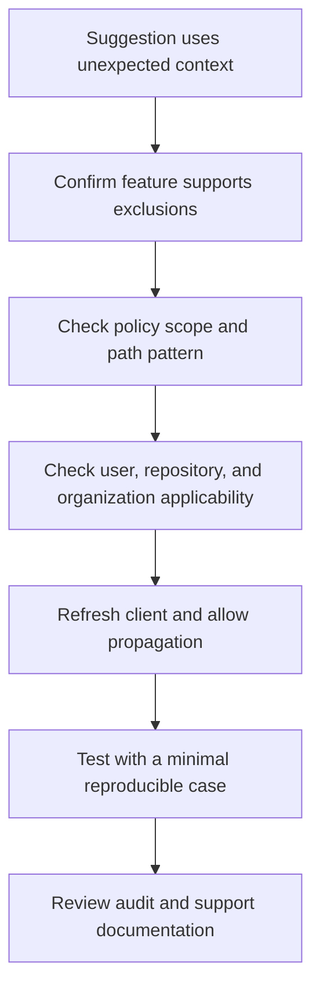

# Configure privacy, content exclusions, and safeguards

Separate three concerns: access control determines who can read content, content exclusion limits supported Copilot context, and safeguards filter or flag certain suggestions. They complement rather than replace one another.

<figure class="product-visual">
    <a href="https://docs.github.com/en/copilot/using-github-copilot/finding-public-code-that-matches-github-copilot-suggestions"></a>
    <figcaption>Official GitHub Docs product visual: <a href="https://docs.github.com/en/copilot/using-github-copilot/finding-public-code-that-matches-github-copilot-suggestions">public code references</a> identify repositories and available license information for similar code.</figcaption>
</figure>

| Control | Purpose | Important limitation |
| --- | --- | --- |
| Repository permissions | Restrict human and application access | Does not configure model behavior by itself |
| Content exclusions | Keep configured paths out of supported Copilot context | Feature support varies; not secret management |
| Public-code matching policy | Allow or block suggestions matching public code | A filter is not a legal or security review |
| Editor settings | Configure client behavior | May be constrained by organization policy |
| Organization policy | Govern feature availability and safeguards | Cannot replace validation of output |

## Content exclusion

Administrators can configure exclusions at supported repository or organization scopes. Use path patterns carefully, allow time for settings to propagate, and test from an affected user's supported client.

```yaml
# Repository-level examples
- "/src/legacy/kernel.rs"
- "secrets.json"
- "secret*"
- "*.cfg"
- "/scripts/**"
```

Patterns use `fnmatch`-style matching and are case insensitive. Repository settings list paths; organization and enterprise settings map repository references to path lists and can also use `"*"` for files outside a Git repository. Enterprise exclusions apply to all Copilot users in the enterprise, while organization exclusions apply to users whose seat is assigned by that organization.

> **Important limitation:** GitHub Copilot CLI and Agent mode in IDEs do not support content exclusion. Check the current [supported surfaces](https://docs.github.com/en/copilot/reference/supported-surfaces-for-policies) before relying on a policy.



Do not commit secrets and rely on exclusions to hide them. Remove exposed credentials, rotate them, clean history when appropriate, and use a secret manager plus repository permissions.

Changes can take up to 30 minutes to reach an IDE that already loaded its settings. In Visual Studio Code, **Developer: Reload Window** refreshes them; other clients have documented refresh behavior. Test a normal file first to confirm suggestions work, then repeat in the excluded file. For Chat, attach only the excluded file and ask Copilot to explain it; a working exclusion prevents the file from appearing as a reference.

## Ownership and public code

GitHub's current terms and documentation govern ownership and data use. Organizations remain responsible for deciding whether generated output is appropriate. When matching-code references are available, inspect the source, repository, and license before using a suggestion. A blocked match can reduce one category of risk but does not prove originality or suitability.

If suggestions matching public code are allowed, Copilot can show references with the matching repository URL and a detected license, or `NOASSERTION`/`unknown` when no license is identified. In Visual Studio Code, accepted inline matches appear in **GitHub Copilot Log (Code References)**. Chat displays a public-code reference link or **View matches**, depending on the client. A missing license is a reason for more investigation, not permission to use the code.

## Audit exclusion changes

<figure class="product-visual">
    <a href="https://docs.github.com/en/copilot/how-tos/configure-content-exclusion/review-changes"></a>
    <figcaption>Official GitHub Docs product visual: the content-exclusion settings link to the relevant <a href="https://docs.github.com/en/copilot/how-tos/configure-content-exclusion/review-changes">audit history</a>.</figcaption>
</figure>

Repository and organization settings show who last changed exclusions and when. Following that timestamp opens audit log entries for `copilot.content_exclusion_changed`. Expand an entry to inspect the resulting `excluded_paths` value and determine the scope and actor responsible for the change.

<figure class="product-visual">
    <a href="https://docs.github.com/en/copilot/how-tos/configure-content-exclusion/review-changes"></a>
    <figcaption>Official GitHub Docs product visual: details for a <code>copilot.content_exclusion_changed</code> audit event.</figcaption>
</figure>

## Troubleshooting checklist

1. Confirm the signed-in account, assigned seat, plan, and policy scope.
2. Verify that the editor, extension, and feature support the expected control.
3. Check exclusion syntax and whether the file path matches.
4. Distinguish delayed propagation from a configuration error.
5. Reproduce with minimal context and collect relevant audit information.
6. Consult current documentation because support differs across Copilot surfaces.

Study [configuring and auditing content exclusion](https://docs.github.com/en/copilot/managing-copilot/configuring-and-auditing-content-exclusion) and [finding public code that matches Copilot suggestions](https://docs.github.com/en/copilot/using-github-copilot/finding-public-code-that-matches-github-copilot-suggestions).

## Readiness check

- Why should a secret never be protected only by content exclusion?
- What should you inspect when a matching-code reference appears?
- What is the first distinction to make while troubleshooting exclusions?

<details markdown="1">
<summary><b>Suggested answers</b></summary>

1. Exclusion is not access control or secret storage, and support varies by feature.
2. Inspect the source, repository, license, and suitability for the project.
3. Confirm that the specific Copilot feature supports content exclusions.
</details>