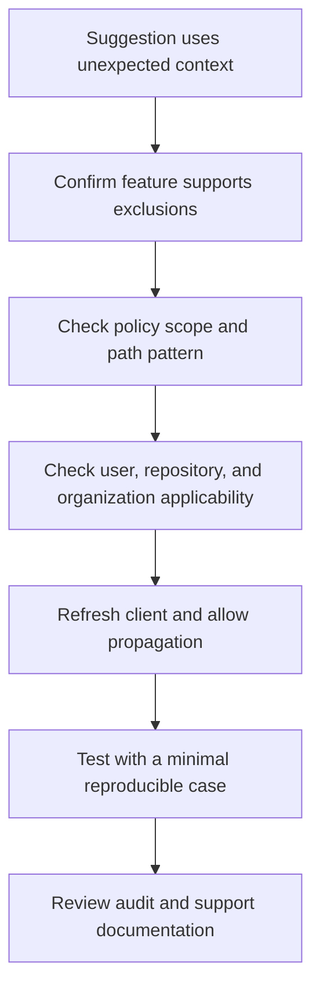

# Configure privacy, content exclusions, and safeguards

Separate three concerns: access control determines who can read content, content exclusion limits supported Copilot context, and safeguards filter or flag certain suggestions. They complement rather than replace one another.

| Control | Purpose | Important limitation |
| --- | --- | --- |
| Repository permissions | Restrict human and application access | Does not configure model behavior by itself |
| Content exclusions | Keep configured paths out of supported Copilot context | Feature support varies; not secret management |
| Public-code matching policy | Allow or block suggestions matching public code | A filter is not a legal or security review |
| Editor settings | Configure client behavior | May be constrained by organization policy |
| Organization policy | Govern feature availability and safeguards | Cannot replace validation of output |

## Content exclusion

Administrators can configure exclusions at supported repository or organization scopes. Use path patterns carefully, allow time for settings to propagate, and test from an affected user's supported client.

Do not commit secrets and rely on exclusions to hide them. Remove exposed credentials, rotate them, clean history when appropriate, and use a secret manager plus repository permissions.

## Ownership and public code

GitHub's current terms and documentation govern ownership and data use. Organizations remain responsible for deciding whether generated output is appropriate. When matching-code references are available, inspect the source, repository, and license before using a suggestion. A blocked match can reduce one category of risk but does not prove originality or suitability.

## Troubleshooting checklist

1. Confirm the signed-in account, assigned seat, plan, and policy scope.
2. Verify that the editor, extension, and feature support the expected control.
3. Check exclusion syntax and whether the file path matches.
4. Distinguish delayed propagation from a configuration error.
5. Reproduce with minimal context and collect relevant audit information.
6. Consult current documentation because support differs across Copilot surfaces.

Study [configuring and auditing content exclusion](https://docs.github.com/en/copilot/managing-copilot/configuring-and-auditing-content-exclusion) and [finding public code that matches Copilot suggestions](https://docs.github.com/en/copilot/using-github-copilot/finding-public-code-that-matches-github-copilot-suggestions).

## Readiness check

- Why should a secret never be protected only by content exclusion?
- What should you inspect when a matching-code reference appears?
- What is the first distinction to make while troubleshooting exclusions?

<b>Suggested answers</b>

1. Exclusion is not access control or secret storage, and support varies by feature.
2. Inspect the source, repository, license, and suitability for the project.
3. Confirm that the specific Copilot feature supports content exclusions.

