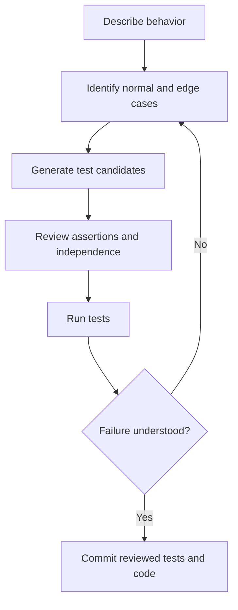

# Improve developer productivity with GitHub Copilot

Copilot is most valuable when it shortens feedback loops without removing engineering controls. Use it to accelerate understanding, implementation, testing, documentation, and modernization, then measure the actual outcome.

## Copilot across the SDLC

Microsoft Learn maps Copilot use cases across the development lifecycle. Copilot can assist each phase, but people still own requirements, architecture, approval, deployment, and operations.

| SDLC phase | Productive assistance | Human control point |
| --- | --- | --- |
| Requirements | Prototype structures, translate user stories, sketch APIs | Confirm stakeholder intent and acceptance criteria |
| Design and development | Generate boilerplate, patterns, translations, and refactors | Review architecture, maintainability, and correctness |
| Testing and quality | Suggest test cases, data, assertions, suites, and pipeline drafts | Verify coverage, independence, and meaningful failures |
| Deployment | Draft configuration, scripts, and documentation | Protect credentials and approve environment changes |
| Maintenance | Explain legacy code, investigate errors, propose fixes | Reproduce the defect and preserve supported behavior |

See the Microsoft Learn unit [AI in the Software Development Lifecycle](https://learn.microsoft.com/en-us/training/modules/developer-use-cases-for-ai-with-github-copilot/4-ai-software-development-lifecycle) for the complete phase-by-phase discussion.

| Use case | Useful context | Required validation |
| --- | --- | --- |
| Code generation | Interface, neighboring patterns, constraints | Compile, tests, review |
| Refactoring | Existing behavior and focused target | Characterization and regression tests |
| Documentation | Public API and intended audience | Technical and link review |
| Learning | Error, minimal example, desired explanation level | Confirm with authoritative docs |
| Sample data | Schema and boundary cases | Remove sensitive data; verify realism |
| Legacy modernization | Tests, compatibility targets, migration limits | Incremental tests and performance checks |

## Testing workflow



Good test prompts name the unit boundary, framework, expected behavior, edge cases, and existing conventions. Generated tests can repeat implementation mistakes, assert the wrong behavior, overuse mocks, or pass without exercising the intended path. Inspect every assertion and intentionally introduce a failure when useful to prove the test detects it.

### Microsoft Learn test-generation workflow

| Need | Recommended starting point |
| --- | --- |
| Explore candidate cases without edits | Ask mode with the target selection attached |
| Plan a broader testing strategy | Plan mode before changing the project |
| Configure a missing framework | `/setupTests` with Agent mode and reviewed tool approvals |
| Generate tests for active code | `/tests` plus success, failure, and edge-case guidance |
| Generate tests for one block | Select it and reference `#selection` |
| Match team conventions | Path-specific `*.instructions.md` for test files |

Agent mode can create or update a test file, run the suite, and iterate on obvious failures. Start with default approvals so commands and tool calls remain visible. Review the diff, choose **Keep** or **Undo**, then independently build and run the tests. Generated cases may still omit important scenarios.

### A stronger test prompt

```text
Generate xUnit tests for CalculateDiscount in #selection.
Follow the Arrange-Act-Assert style used in the adjacent test class.
Cover zero, negative values, the threshold boundary, and overflow.
Do not change production code or add packages.
Run the focused test project and report any failure you cannot explain.
```

## Security and performance

Ask Copilot to identify risks, not to certify safety. Useful review areas include input validation, authorization, injection, secret handling, dependency use, error disclosure, algorithmic complexity, allocation, network calls, and database access. Confirm findings with security tools, profiling, documentation, and human review.

## Measure actual impact

Avoid treating suggestion count or lines generated as productivity outcomes. Compare lead time, review time, escaped defects, test quality, rework, developer satisfaction, and task completion for a defined baseline and trial period. Faster drafting can be offset by slower review or correction, so measure the complete workflow.

## Reduce context switching

- Ask for an explanation at the code location instead of leaving the IDE.
- Generate a first draft of repetitive code, tests, or documentation.
- Summarize a pull request before reviewing its actual diff.
- Translate an error into likely causes and discriminating checks.
- Modernize in small behavior-preserving steps rather than one broad rewrite.

Study [developer use cases for AI](https://learn.microsoft.com/en-us/training/modules/developer-use-cases-for-ai-with-github-copilot/) and [develop unit tests using GitHub Copilot tools](https://learn.microsoft.com/en-us/training/modules/develop-unit-tests-using-github-copilot-tools/).

## Readiness check

- Why should refactoring begin with behavior coverage?
- What makes a generated test untrustworthy even when it passes?
- How should Copilot security suggestions be used?

<details markdown="1">
<summary><b>Suggested answers</b></summary>

1. Characterization tests detect unintended behavior changes during modernization.
2. It may assert the wrong outcome, mirror the implementation, or never exercise the target path.
3. As review leads that must be verified with tools, documentation, and human judgment.
</details>