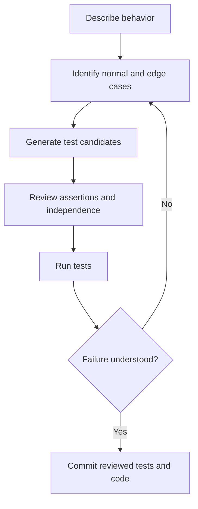

# Improve developer productivity with GitHub Copilot

Copilot is most valuable when it shortens feedback loops without removing engineering controls. Use it to accelerate understanding, implementation, testing, documentation, and modernization, then measure the actual outcome.

| Use case | Useful context | Required validation |
| --- | --- | --- |
| Code generation | Interface, neighboring patterns, constraints | Compile, tests, review |
| Refactoring | Existing behavior and focused target | Characterization and regression tests |
| Documentation | Public API and intended audience | Technical and link review |
| Learning | Error, minimal example, desired explanation level | Confirm with authoritative docs |
| Sample data | Schema and boundary cases | Remove sensitive data; verify realism |
| Legacy modernization | Tests, compatibility targets, migration limits | Incremental tests and performance checks |

## Testing workflow

Good test prompts name the unit boundary, framework, expected behavior, edge cases, and existing conventions. Generated tests can repeat implementation mistakes, assert the wrong behavior, overuse mocks, or pass without exercising the intended path. Inspect every assertion and intentionally introduce a failure when useful to prove the test detects it.

## Security and performance

Ask Copilot to identify risks, not to certify safety. Useful review areas include input validation, authorization, injection, secret handling, dependency use, error disclosure, algorithmic complexity, allocation, network calls, and database access. Confirm findings with security tools, profiling, documentation, and human review.

## Reduce context switching

- Ask for an explanation at the code location instead of leaving the IDE.
- Generate a first draft of repetitive code, tests, or documentation.
- Summarize a pull request before reviewing its actual diff.
- Translate an error into likely causes and discriminating checks.
- Modernize in small behavior-preserving steps rather than one broad rewrite.

Study [developer use cases for AI](https://learn.microsoft.com/en-us/training/modules/developer-use-cases-for-ai-with-github-copilot/) and [develop unit tests using GitHub Copilot tools](https://learn.microsoft.com/en-us/training/modules/develop-unit-tests-using-github-copilot-tools/).

## Readiness check

- Why should refactoring begin with behavior coverage?
- What makes a generated test untrustworthy even when it passes?
- How should Copilot security suggestions be used?

<b>Suggested answers</b>

1. Characterization tests detect unintended behavior changes during modernization.
2. It may assert the wrong outcome, mirror the implementation, or never exercise the target path.
3. As review leads that must be verified with tools, documentation, and human judgment.

