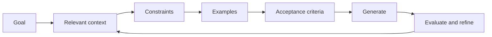

# Apply prompt engineering and context crafting

An effective prompt makes the desired outcome, relevant context, constraints, and validation criteria explicit. Prompt engineering is iterative: inspect the result, identify the missing signal, and refine deliberately.

<figure class="product-visual">
    <a href="https://docs.github.com/en/copilot/how-tos/chat-with-copilot/chat-in-ide"></a>
    <figcaption>Image source: <a href="https://docs.github.com/en/copilot/how-tos/chat-with-copilot/chat-in-ide">GitHub Docs, Copilot Chat in Visual Studio Code</a>.</figcaption>
</figure>

| Prompt element | Example purpose |
| --- | --- |
| Goal | State the concrete result to produce |
| Context | Identify relevant files, APIs, users, or business rules |
| Constraints | Set language, dependencies, compatibility, security, or scope |
| Examples | Demonstrate the expected pattern or output shape |
| Acceptance criteria | Define tests and observable success conditions |



## Prompting approaches

| Approach | Meaning | Use when |
| --- | --- | --- |
| Zero-shot | Give instructions without an example | The task and output format are familiar and clear |
| One-shot | Include one representative example | A single pattern clarifies style or structure |
| Few-shot | Include several examples | The task needs a nuanced or repeated pattern |
| Stepwise decomposition | Divide a large goal into verifiable tasks | Scope is broad or dependencies must be discovered |

More context is not automatically better. Irrelevant files, stale chat history, and contradictory instructions reduce signal. Attach authoritative sources, select the smallest useful code area, and state which source wins when constraints conflict.

### Techniques from the official guidance

1. **Start general, then get specific.** Introduce the scenario before listing detailed behavior, error handling, compatibility, and output requirements.
2. **Give examples.** Provide representative input, expected output, or an existing implementation pattern. Tests can serve as executable examples.
3. **Break down complex work.** Request small, independently verifiable functions or phases instead of one broad result.
4. **Avoid ambiguous references.** Name the function, file, response, library, or framework instead of saying “this” or “make it work.”
5. **Indicate relevant code.** Select code or attach files and symbols explicitly; close irrelevant files when the client uses open editors as context.
6. **Experiment and iterate.** Explain what is wrong with the result and refine one missing constraint at a time.
7. **Keep history relevant.** Begin a new thread for a new task and remove stale turns when supported.

## Practical prompt pattern

```text
Goal: Add validation for the registration endpoint.
Context: Follow the patterns in the adjacent login handler and tests.
Constraints: Keep the public response schema unchanged; add no dependency.
Acceptance: Reject malformed email addresses and preserve existing tests.
Validation: Run the focused test suite and report failures.
```

Chat history becomes context, not guaranteed memory. Correct an incorrect premise explicitly. For a new unrelated task, start a focused conversation to avoid carrying irrelevant assumptions.

### Diagnose a weak response

| Symptom | Likely prompt problem | Better follow-up |
| --- | --- | --- |
| Wrong framework | Dependency was implicit | “Use xUnit already referenced by `Project.Tests.csproj`; add no package.” |
| Missed edge cases | Only the happy path was described | List boundaries, invalid inputs, and expected failures. |
| Broad unrelated edits | Scope was undefined | Name allowed files and state what must remain unchanged. |
| Invented API | Source of truth was absent | Attach current API documentation or the interface definition. |
| Repeated bad assumption | Stale history remains active | Correct it explicitly or start a new focused thread. |

Study [prompt engineering for Copilot Chat](https://docs.github.com/en/copilot/concepts/prompting/prompt-engineering) and [best practices for using GitHub Copilot](https://docs.github.com/en/copilot/get-started/best-practices).

## Readiness check

- When does few-shot prompting add value?
- Why can attaching an entire repository reduce answer quality?
- What should acceptance criteria describe?

<details markdown="1">
<summary><b>Suggested answers</b></summary>

1. When several examples clarify a nuanced pattern or output format better than instructions alone.
2. Irrelevant context competes with important signals and consumes the context window.
3. Observable conditions that can validate whether the result meets the goal.
</details>