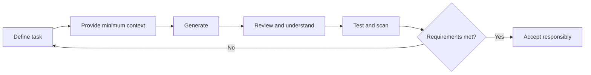

# Use GitHub Copilot responsibly

Generative AI output is probabilistic, not authoritative. Treat Copilot as an assistant whose suggestions require human understanding, review, testing, and accountability.

| Risk or limitation | Example | Mitigation |
| --- | --- | --- |
| Inaccuracy | Plausible code calls a nonexistent API | Verify documentation, compile, and test |
| Bias or unfairness | Output reflects stereotypes in training data | Review assumptions and impact on users |
| Security weakness | Generated code handles input unsafely | Apply secure review and security scanning |
| Privacy leakage | A prompt includes sensitive data | Minimize context and follow policy |
| Overreliance | Output is accepted without understanding it | Require accountable human review |
| Public-code similarity | A suggestion resembles public code | Use matching-code controls and inspect references |

## Responsible AI principles

| Principle | Question to ask |
| --- | --- |
| Fairness | Does the result work equitably across affected groups? |
| Reliability and safety | Has it been tested for expected and unexpected inputs? |
| Privacy and security | Is sensitive information protected? |
| Inclusiveness | Can people with different abilities and contexts use it? |
| Transparency | Is AI involvement and uncertainty understandable? |
| Accountability | Is a person responsible for the final impact? |

Copilot does not remove responsibility for correctness, licensing, security, accessibility, or policy compliance. High-impact decisions need stronger controls than low-risk drafting tasks.

## Match oversight to risk

| Scenario | Risk signal | Appropriate response |
| --- | --- | --- |
| Drafting an internal comment | Low impact and easy to reverse | Read for accuracy and clarity |
| Generating an authentication handler | Security boundary | Threat-model, test, scan, and require peer review |
| Suggesting a hiring decision | Material impact on people | Do not delegate the decision; apply formal fairness and governance controls |
| Modernizing a payment calculation | Financial and regression risk | Preserve behavior with characterization tests and domain-owner approval |
| Producing third-party-like code | Intellectual-property uncertainty | Inspect code references, source, and license before use |

Responsible operation includes deciding when *not* to use generated output. Do not use Copilot as the final authority for legal, medical, employment, financial, security, or other high-impact decisions. Keep sensitive data out of prompts unless its use is explicitly approved and protected by the applicable service terms and organizational controls.

## Validation workflow

1. Read the complete suggestion and explain what it does.
2. Confirm APIs, dependencies, and assumptions against authoritative sources.
3. Run formatting, compilation, tests, and security checks.
4. Review edge cases, failure handling, accessibility, privacy, and performance.
5. Use normal peer-review and approval controls before release.

### What automated checks can and cannot prove

- A compiler can prove that code satisfies language rules, not that the requirement is correct.
- Unit tests can confirm selected examples, not every possible behavior.
- Security scanning can identify known patterns, not guarantee the absence of vulnerabilities.
- Public-code filters can detect some matches, not establish ownership or suitability.
- A human review can add domain judgment, but it should be supported by repeatable evidence.

Study [Responsible AI with GitHub Copilot](https://learn.microsoft.com/en-us/training/modules/responsible-ai-with-github-copilot/) and [responsible use of code completion](https://docs.github.com/en/copilot/responsible-use/copilot-code-completion).

## Readiness check

- Why can syntactically valid output still be unsafe?
- Which principle applies when prompts contain personal data?
- Who remains accountable after accepting a suggestion?

<b>Suggested answers</b>

1. Valid code can still have insecure logic, false assumptions, bias, licensing concerns, or missed edge cases.
2. Privacy and security; minimize sensitive context and follow policy.
3. The people and organization using the output remain accountable.

